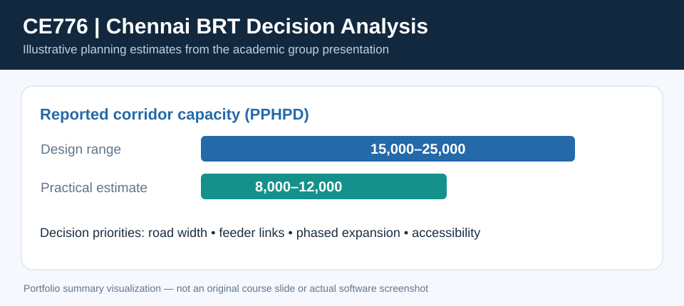

# CE776 | Chennai Bus Rapid Transit System — Project Evaluation




**IIT Bombay Academic Group Project**  
**Course:** CE776 — Transportation Project Evaluation and Decision Making  
**Presentation:** CE776 Course Project Stage-2, *Bus Rapid Transit System in Chennai* (15 slides)  
**Team:** Five students | **Contributor:** Vura Lohith Kumar

> **Personal contribution (confirmed by contributor):** Secondary research/data collection, analysis of user costs and travel-time savings, multi-criteria decision analysis, recommendations, and presentation.
>
> This is a student **project evaluation based on secondary sources and scenario assumptions**, not an implemented BRT project or a commissioned appraisal. Figures are presented as the team's *reported projections/assumptions*, not independently validated real-world outcomes.

## Business problem

The team explored the economic, social, and environmental case for a proposed Chennai Bus Rapid Transit System (BRTS). The presentation describes a **120 km, seven-corridor** network and considers public transit access, congestion, reliability, costs, and integration with metro and suburban rail.

## My contributions

- Collected and synthesized secondary source information on proposed BRT demand, system costs, corridor constraints, and user benefits.
- Analyzed the user-cost and travel-time savings framework, including vehicle operating costs and time-value assumptions.
- Contributed to **multi-criteria decision analysis (MCDA)** covering economic costs/returns, environmental impacts, and social accessibility/equity.
- Helped translate findings into practical recommendations and presented the team's evaluation.

## Methods and frameworks discussed in the project

| Dimension | Evaluation elements |
|---|---|
| Demand and supply | Projected ridership, fleet/corridor constraints, mode shift, road right-of-way, feeder connectivity |
| Financial/economic | Capital expenditure, life-cycle costs, benefit-cost ratio, NPV, IRR, sensitivity scenarios (group-level presentation) |
| User costs | Vehicle operating cost (VOC) scenarios, hypothetical travel-time savings, commuter value of time |
| Multi-criteria assessment | Economic, environmental and social factors |
| Recommendations | Phased expansion, route integration, last-mile access, preventive maintenance, performance reviews |

**Individual attribution:** Although group slides contain NPV/IRR and sensitivity analysis tables, I do **not** claim to have personally calculated NPV/IRR, authored the entire appraisal, or gathered primary survey data.

## Reported project context

- Proposed project: 120 km / seven corridors.
- Headline cost reported: **₹2,132.9 crore**; the same slide's phase costs sum to **₹2,154.27 crore**, so the headline is not reconciled.
- Travel-time analysis uses scenario inputs such as **25 minutes per bus trip**, **₹120 per passenger-hour**, and **40 passengers per bus**.
- Multi-criteria framing covers project economics, emissions and air quality, commuter safety, access, and equitable public transport coverage.

### Source-derived (not independently verified) numbers

See [presentation_metrics.csv](./data/presentation_metrics.csv) and [scenario_summary.csv](./data/scenario_summary.csv) for transcribed values and source-slide traceability. These are **reported figures**, not observed project performance.

## Major data-quality cautions

1. **Capital cost mismatch**: headline ₹2,132.9 crore vs phases ₹1,006.73 crore + ₹1,147.54 crore = ₹2,154.27 crore (slide 2).
2. **Benefit-cost ratio mismatch**: slide 9 base BCR 2.14 vs slide 14 BCR 1.67. Different definitions were not documented.
3. **Travel-time arithmetic**: 25 min × ₹120/hr × 40 passengers × 5,450 trips/day = **₹109 lakh/day**, not the **₹10.91 lakh/day** shown on slide 10. This simple check assumes every trip has 40 passengers each saving 25 minutes; the original table does not resolve why the numbers differ.
4. **NPV, IRR and payback**: source documents and calculation workbook were not provided, so this repository **does not independently substantiate** those outcomes.
5. The slide deck mixes economic/financial measures and different assumed project costs/discount rates; comparisons require a consistent model.

A more detailed traceability and arithmetic note is in [SOURCE_NOTES.md](./SOURCE_NOTES.md).

## Reproducibility

The script [check_reported_numbers.py](./check_reported_numbers.py) recomputes only simple arithmetic checks on disclosed inputs. **It does not attempt to recreate the NPV, IRR, BCR, or forecasts without missing cash-flow data.** It was prepared as later portfolio documentation rather than original course code.

Run it using standard Python:
```bash
python check_reported_numbers.py
```

## Interview framing

> "I worked with four teammates on a course evaluation of a proposed Chennai BRT system. My part focused on secondary research, analysis of user costs and time savings, multi-criteria evaluation, recommendations, and presenting the findings. We considered economic, environmental, and access-related trade-offs. The financial scenario metrics came from the group's presentation; I would want the original model to independently validate the returns."

**Original source:** CE776 15-slide course project presentation, stage 2. The unredacted PDF is not published here because it includes the names and student identifiers of other team members.

## Relevant skills

Secondary Research · Economic Evaluation Concepts · User Cost Analysis · Multi-Criteria Decision Analysis · Decision Support · Report Writing · Presentation · Teamwork
