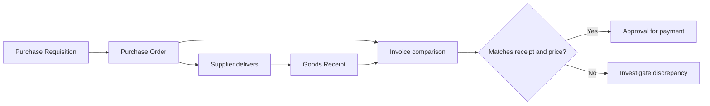

# SAP MM / S/4HANA — Procure-to-Pay Portfolio Simulation


**IIT Bombay graduate portfolio | Excel + SQL + procurement process analysis**

A reproducible, **synthetic** procurement dataset and analytical case study exploring Purchase Requisition (PR), Purchase Order (PO), Goods Receipt (GR), supplier delivery performance, and invoice matching.

> **Scope disclosure:** This is an educational portfolio simulation, **not** SAP system implementation, SAP GUI configuration, SAP certification, a live SAP extract, or paid client experience. The tables imitate selected procurement business concepts; they are **not actual SAP database tables**.

## Quick facts — independently checked against `p2p_raw_data.csv`

| Metric | Recalculated value | Definition |
|---|---:|---|
| Simulated purchase lines | 240 | One synthetic PR/PO line per row |
| Distinct materials / suppliers | 40 / 12 | Unique material and supplier IDs |
| PO-line value proxy | **₹28,304,713.10** (≈₹2.83 crore) | Sum of PR_Qty × Unit_Price_INR; no separate PO_Qty field |
| Goods receipt recorded | **217** | Nonempty GR_Date |
| No receipt recorded | **23** | Empty GR_Date; includes lines not yet received |
| On-time receipts | **180 / 217 = 82.95%** | GR_Date ≤ Expected_Delivery_Date |
| Average order-to-receipt time | **10.95 days** | Among rows with a GR_Date |
| Partial/quantity-different receipts | **14** | GR_Qty ≠ PR_Qty on received rows |
| Invoice-line match rate | **177 / 217 = 81.57%** | Invoice_Qty = GR_Qty, Invoice_Qty ≤ PR_Qty, invoice amount ≈ invoice qty × unit price (₹1 tolerance) |
| Invoice-amount discrepancy | **40** | Invoice amount differs from Invoice_Qty × Unit_Price_INR by over ₹1 |
| Lines with ≥1 exception flag | **63** | Missing GR, unequal receipt quantity, mismatched invoice quantity/amount, or missing invoice |

*All values refer to **fabricated test records** for Jan–Sep 2026, not a real organization's procurement performance. “81.57% match” is a **simplified portfolio control**, not an SAP-configured invoice tolerance or a certified three-way-match rate.*

## Business scenario & findings

**Scenario:** An engineering/construction procurement team needs visibility into orders, supplier delays, partial receipts, and invoice discrepancies.

**What the analysis shows:** 23 lines lack a receipt, 14 received lines have a quantity difference, and 40 invoiced lines have an invoice-value discrepancy under the defined rule. The data therefore suggests three follow-up workflows for a **simulated** procurement team: request status tracking, receiving reconciliation, and an invoice exception queue. See [CASE_STUDY.md](./CASE_STUDY.md).

## Process map



The dataset has a `Payment_Status` field, but there is no independent evidence of postings in a real SAP accounting system.

## Repository navigation

| File | Purpose |
|---|---|
| [p2p_raw_data.csv](./p2p_raw_data.csv) | 240 synthetic purchase-line records |
| [SAP_MM_Procure_to_Pay_Project.xlsx](./SAP_MM_Procure_to_Pay_Project.xlsx) | Existing Excel workbook and analysis |
| [analysis_queries.sql](./analysis_queries.sql) | Revised, SQLite-compatible reporting and exception checks |
| [validate_procurement.py](./validate_procurement.py) | Reproduce core metrics using Python standard library |
| [CASE_STUDY.md](./CASE_STUDY.md) | Problem, findings, recommendations, and interview-ready interpretation |
| [DATA_DICTIONARY.md](./DATA_DICTIONARY.md) | Full field definitions, proxy assumptions and data constraints |
| [TEST_CASES.md](./TEST_CASES.md) | Reconciliation/exception scenarios and expected results |
| [portfolio-preview.svg](./portfolio-preview.svg) | Newly created portfolio visual summary; not an SAP screenshot |

## Run independently

Python 3 required; **no external packages**:
```bash
python validate_procurement.py
```

For SQLite, import the CSV as a table called `p2p_raw_data`, then run `analysis_queries.sql`. The SQL is written for SQLite's ISO-date-string conventions, not for the SAP HANA SQL dialect.

## SAP MM / S/4HANA concepts illustrated

- Procurement lifecycle: **PR → PO → Goods Receipt → Invoice Verification**
- Material and supplier reference information
- Purchase quantity, received quantity and invoice quantity comparisons
- Supplier on-time delivery monitoring
- Open receipts, partial deliveries, invoice exception triage
- Spend/value estimation and operational KPI documentation

**Portfolio skills:** Procurement Process Mapping · SAP MM Concepts · Excel · SQL · Data Validation · Reporting · Business Process Analysis.

## Interview-ready description

> “I built a synthetic procurement analysis portfolio project to learn SAP MM procure-to-pay concepts. I used Excel and SQL to examine 240 mock purchase lines, tracking receipts, delays, supplier activity, and invoice inconsistencies. I validated the KPI definitions using a Python script. I have not worked in a live SAP system yet.”

**Recommended target roles:** SAP MM Trainee, SAP Procurement Support Trainee, ERP Support / Master Data Trainee, Procurement Data Analyst, Purchasing Operations Analyst.

Related portfolio: [BuildBridge BA case study](../buildbridge-procurement-ba-case-study/) · [CE776 Infrastructure Project Evaluation](../ce776-chennai-brt-project-evaluation/) · [CE774 Traffic Research](../ce774-traffic-impact-vissim-study/).
